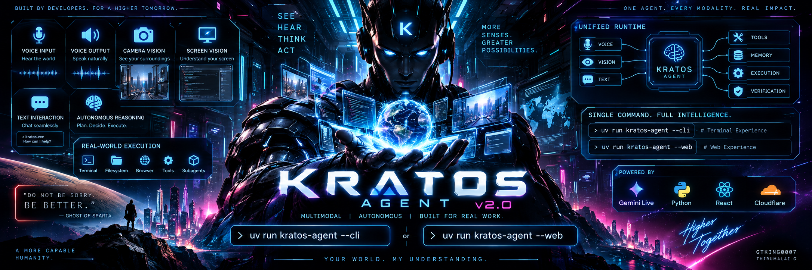
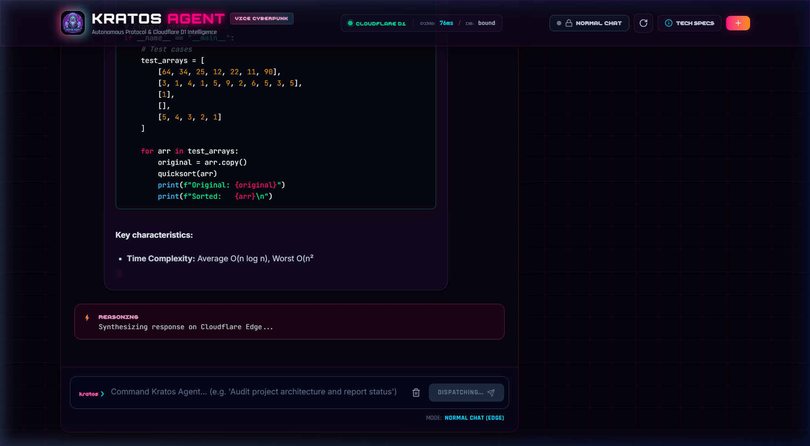

<div align="center">



# ⚔️ KRATOS AGENT // VICE CYBERPUNK EDITION

### *"Do not be sorry. Be better."* — Ghost of Sparta

**Autonomous Full-Stack AI Coding Agent featuring Universal LLM Brain, Real-Time Token Streaming, Dynamic Step Planning, Self-Forging Tool Engine, 4-Tier Cognitive Memory, Cloudflare D1 Persistence, Plugin Harness Architecture, and Senior Claude Code Engineering Workflows.**

[](https://www.python.org/)
[](https://github.com/astral-sh/uv)
[](https://vitejs.dev/)
[](https://tailwindcss.com/)
[](https://workers.cloudflare.com/)
[](LICENSE)
[](https://github.com/Piebald-AI/claude-code-system-prompts)
[](#-built-in-tool-registry)
[-cyan.svg)](https://github.com/headroomlabs-ai/headroom)
[](#-parallel-tool--subagent-execution-wave-scheduler)
[-magenta.svg)](#-multimodal-live-voice--vision-integration)
[-brightgreen.svg)](#-testing--quality-assurance)

[🌐 Live Cloudflare Web Version](https://kratos-agent.thirutechdeveloper.workers.dev) • [🎤 Multimodal Live](#-multimodal-live-voice--vision-integration) • [🎮 Quickstart](#-quickstart-cli-version-vs-web-version) • [🖥️ CLI Version](#️-1-cli-version-terminal-shell--one-shot-mode) • [🌐 Web Version](#-2-web-version-vice-city-cyberpunk-console) • [📜 Slash Commands](#-complete-cli-slash-commands-reference)

</div>

---

## 📑 Table of Contents

- [⚡ Overview](#-overview)
- [🎤 Multimodal Live: Voice & Vision Integration](#-multimodal-live-voice--vision-integration)
- [🎮 Quickstart: CLI Version vs Web Version](#-quickstart-cli-version-vs-web-version)
  - [🖥️ 1. CLI Version (Terminal Shell & One-Shot Mode)](#️-1-cli-version-terminal-shell--one-shot-mode)
  - [🌐 2. Web Version (Vice City Cyberpunk Console)](#-2-web-version-vice-city-cyberpunk-console)
  - [☁️ 3. Cloudflare Edge Version (Live Serverless Web App)](#️-3-cloudflare-edge-version-live-serverless-web-app)
- [🚀 Key Features](#-key-features)
- [🧠 The Brain Subsystem & Streaming Gateway](#-the-brain-subsystem--streaming-gateway)
- [⚙️ Architecture & Execution Pipeline](#️-architecture--execution-pipeline)
- [🔌 Harness & Plugin Architecture](#-harness--plugin-architecture)
- [🧬 4-Tier Cognitive Memory](#-4-tier-cognitive-memory)
- [🗜️ Headroom Context Compression (20-60% Token Savings)](#️-headroom-context-compression-20-60-token-savings)
- [⚡ Parallel Tool & Subagent Execution (Wave Scheduler)](#-parallel-tool--subagent-execution-wave-scheduler)
- [📦 Installation & Environment Setup](#-installation--environment-setup)
- [🔑 Configuration & Environment Variables (.env)](#-configuration--environment-variables-env)
- [🖥️ Standalone Windows Executable (.exe)](#️-standalone-windows-executable-exe)
- [📜 Complete CLI Slash Commands Reference](#-complete-cli-slash-commands-reference)
- [🛡️ Execution & Approval Modes](#️-execution--approval-modes)
- [🗡️ Autonomous Tool Forging](#️-autonomous-tool-forging)
- [🔧 Built-in Tool Registry](#-built-in-tool-registry)
- [🧪 Testing & Quality Assurance](#-testing--quality-assurance)
- [🗄️ Cloudflare D1 Database Schema](#️-cloudflare-d1-database-schema)
- [🎨 Frontend Component Architecture](#-frontend-component-architecture)
- [📡 TUI (Terminal User Interface) Subsystem](#-tui-terminal-user-interface-subsystem)
- [🏗️ Complete Directory Structure](#️-complete-directory-structure)
- [🛡️ License](#️-license)

---

## ⚡ Overview

**Kratos Agent** is a dual-interface autonomous AI coding agent designed for senior developer workflows, workspace mutation, and shell execution. It operates both as a high-octane **Interactive Terminal CLI** and as a **Vice City Cyberpunk Web Console** with true real-time token-by-token streaming, Cloudflare D1 persistence, and live tool orchestration.

Equipped with the complete **Claude Code System Prompts & Sub-Agents suite** (695+ indexed prompts, workflows, and sub-agents), Kratos delivers:

- **Multimodal Live Perception**: Direct bidirectional Gemini Live integration providing natural voice hearing, voice output, camera vision, and screen vision running synchronously alongside the Kratos execution brain.
- **True Autonomous Planning**: Breaks complex tasks into verifiable sub-goals with dynamic state machines (`PENDING` → `RUNNING` → `COMPLETED`).
- **Real-Time Token Streaming**: True SSE incremental token streaming across both local Python runtime and Cloudflare Edge Worker (`cloudflare:sockets`).
- **Workspace File Operations**: Inspects, searches, creates, and surgical-edits files with localized context.
- **Terminal Execution & Verification**: Executes tests, compiles code, runs linters, and verifies deliverables before completing turns.
- **Self-Forging Tool Engine**: Synthesizes and hot-reloads new Python tools at runtime when needed.
- **Headroom Context Compression**: Integrated 3-layer context compression (context pipeline, compactor, harness plugin) saving 20-60% tokens on tool results, logs, and history.
- **Parallel Tool & Subagent Concurrency**: Wave scheduler partitions LLM tool calls into concurrent batches for read-only tools and distinct-path writes, while running multi-role subagents simultaneously.
- **4-Tier Cognitive Memory**: Working, Episodic, Semantic, and Procedural memory tiers with dual D1/SQLite persistence.
- **Plugin Harness Architecture**: Extensible kernel-based plugin system for model adapters, memory, auditing, and tool injection.
- **MCP Protocol Support**: Model Context Protocol integration for external tool servers.

---

## 🎤 Multimodal Live: Voice & Vision Integration

Kratos Agent features a unified multimodal perception layer powered directly by the **Gemini Live API** (`gemini-3.8-live-extended-thinking`). Gemini Live acts as the **ears, voice, and eyes** of the system, while Kratos remains the **autonomous execution brain**.

```text
USER ───► [ 🎤 SPEAK / 👁️ CAMERA / 🖥️ SCREEN ]
                    │
                    ▼
          ┌───────────────────┐
          │   GEMINI LIVE     │
          │                   │
          │ Hearing           │
          │ Vision            │
          │ Conversation      │
          │ Voice             │
          └─────────┬─────────┘
                    │
                    │ start_agent_task(desc, visual_context)
                    ▼
          ┌───────────────────┐
          │   KRATOS BRIDGE   │
          └─────────┬─────────┘
                    │
                    ▼
          ┌───────────────────┐
          │   KRATOS AGENT    │
          │                   │
          │ Planner           │
          │ Agent Loop        │
          │ Tools & Terminal  │
          │ Memory & D1       │
          │ Verification      │
          └─────────┬─────────┘
                    │
                    │ runtime events
                    ▼
          ┌───────────────────┐
          │  NARRATION LAYER  │
          └─────────┬─────────┘
                    │
                    ▼
               GEMINI LIVE
                    │
                    ▼
             [ 🔊 SPEAKER ]
```

### 🌟 Key Capabilities
* 🎤 **Voice Hearing & Speech Understanding**: 16kHz 16-bit PCM streaming microphone listener with real-time transcription and automatic interruption handling.
* 🔊 **Natural Voice Output**: 24kHz 16-bit PCM speaker output playing Gemini's spoken replies with zero conversational latency.
* 👁️ **Camera Vision**: Real-time video frame capture via OpenCV (`cv2.VideoCapture`) with automatic thumbnail compression and ~1 FPS throttling.
* 🖥️ **Screen Vision**: Primary monitor capture via `mss` with automatic aspect ratio scaling and ~1 FPS throttling.
* 🧠 **Single Unified Runtime**: No separate "Live Agent" or duplicate planners. Gemini Live delegates workspace tasks to Kratos through the current Master/Slave bridge using non-blocking Live tools (`delegate_task`, `search`, `observe`, `get_task_status`, `cancel_task`, `continue_task`, with `start_agent_task` retained as a compatibility alias).
* 🎙️ **Event Narration**: High-signal execution milestones (`INSPECTING`, `PLANNING`, `MODIFYING`, `RUNNING_TESTS`, `VERIFYING`, `COMPLETED`) are automatically sanitized and narrated in natural speech.
* 🛡️ **Fault Isolation**: If microphone or camera is unavailable, Kratos CLI and Web continue operating normally without interruption.

### 🔧 Gemini Live Reliability & Error Isolation

The Live integration is aligned with the current **Gemini 3.8 Live Extended Thinking** contract:

- Live function declarations use `behavior="NON_BLOCKING"`.
- The runtime tracks `interaction_status` (`IN_PROGRESS` / `IDLE`) instead of treating `turnComplete` as the end of the whole extended-thinking interaction.
- Component failures are isolated and reported separately for Gemini, microphone, speaker, camera, and screen capture.
- `/voice on|off` controls the microphone only; speaker output remains available.
- Screen/camera capture failures do not terminate the Gemini or Kratos runtime.
- Gemini credentials are resolved from the project environment; no machine-specific `C:\\Users\\...` fallback path is used.

### ⚡ Single-Command Startup

You **NEVER** need to run `python live.py` or any secondary script. The Live subsystem starts automatically with Kratos:

#### Starting the CLI with Live
```bash
uv run kratos-agent --cli
```
Automatically launches:
1. Kratos CLI Shell
2. Gemini Live Session
3. Microphone Listener
4. Speaker Output
5. Camera or Screen Vision
6. Kratos Bridge & Narration

#### Starting the Web Console with Live
```bash
uv run kratos-agent --web
```
Automatically launches:
1. Kratos Web Server & Console (`http://127.0.0.1:7860`)
2. Gemini Live Multimodal Subsystem in background
3. Web REST API endpoints for Live status and controls (`/api/live/status`, `/api/live/control`)
4. Interactive Live perception bar in the Web UI

### 📜 CLI Slash Commands for Multimodal Live
| Command | Description |
|---|---|
| `/voice` | Toggle microphone mute on/off |
| `/voice on` | Unmute microphone and enable voice hearing |
| `/voice off` | Mute microphone voice input |
| `/vision` | Show current vision capture mode |
| `/vision camera` | Set vision source to camera |
| `/vision screen` | Set vision source to screen capture |
| `/vision both` | Enable both camera and screen vision |
| `/vision off` | Disable vision capture |
| `/live status` | View detailed Live subsystem status table |
| `/live reconnect` | Reconnect the Gemini Live session |

---

---

## 🎮 Quickstart: CLI Version vs Web Version

Kratos Agent can be launched in **CLI Mode** for terminal enthusiasts or **Web Mode** for a rich graphical experience:

```
                               ┌─────────────────────────────┐
                               │     uv run kratos / CLI     │
                               └──────────────┬──────────────┘
                                              │
                     ┌────────────────────────┴────────────────────────┐
                     ▼                                                 ▼
        ┌───────────────────────────┐                     ┌───────────────────────────┐
        │   🖥️  CLI VERSION         │                     │   🌐  WEB VERSION         │
        │   uv run kratos --cli     │                     │   uv run kratos           │
        ├───────────────────────────┤                     ├───────────────────────────┤
        │ • Interactive prompt shell│                     │ • Vice Cyberpunk 2077 UI  │
        │ • Live Task Tree TUI      │                     │ • Live Token Streaming    │
        │ • 30+ Slash Commands      │                     │ • Agent & Normal Chat     │
        │ • Approval Gates          │                     │ • D1 Intelligence & SQL   │
        │ • Direct 1-shot execution │                     │ • Code Highlighter + Copy │
        └───────────────────────────┘                     └───────────────────────────┘
```

---

### 🖥️ 1. CLI Version (Terminal Shell & One-Shot Mode)

The CLI version runs directly in your terminal with animated step trees, syntax highlighting, and slash commands:

#### A. Interactive Shell Mode
Start the interactive prompt_toolkit shell:
```bash
# Recommended command:
uv run kratos --cli

# Alternative alias:
uv run kratos-agent --cli
```
Inside the interactive shell:
- Type your prompt and press **Enter** to start autonomous execution.
- Use **Tab** to autocomplete commands and file paths.
- Attach files to prompts with `@filename` (e.g. `explain the architecture of @server.py`).
- Run slash commands like `/session`, `/review`, `/simplify`, `/security`, `/model`, `/mode`.

#### B. Direct One-Shot Command Execution
Pass a prompt directly to execute without entering the interactive shell:
```bash
# Run a one-shot coding task:
uv run kratos "Audit src/kratos_agent/brain for error handling and write unit tests"

# Build a full web application:
uv run kratos "Create a full-stack Flask application in ./demo with JWT auth and SQLite"
```

---

### 🌐 2. Web Version (Vice City Cyberpunk Console)

The Web version runs a local server connecting the Python runtime with the React 19 / Vite Vice City Cyberpunk web interface:

<div align="center">

</div>

#### A. Starting the Web Server
```bash
# Start the Web Console (opens your default browser at http://127.0.0.1:7860 automatically):
uv run kratos

# Or explicitly pass the --web flag:
uv run kratos --web

# Custom port (e.g., port 8080):
uv run kratos --web 8080
```

#### B. Web Console Features
- **Vice City Cyberpunk Aesthetic**: High-energy neon magenta, cyan, and purple theme with custom `Pixl` font typography (OTF + TTF included).
- **Dual Execution Modes**:
  - 🛡️ **Autonomous Agent Mode**: Protected by security clearance (Passcode: `kratos`). Executes multi-step autonomous planning, shell commands, file modifications, and live verification.
  - 💬 **Normal Chat Mode**: Fast unrestricted technical conversation with live model streaming.
- **Real-Time Token Streaming**: Server-Sent Events (SSE) deliver tokens live as the model generates them.
- **Code Highlighter**: Complete Highlight.js (bundled 121KB) syntax highlighting with language detection and 1-click clipboard copy.
- **Cloudflare D1 Intelligence**: Live turn telemetry, active session switcher, trace visualizer, and an interactive **SQL Playground** for querying the database.
- **100% Responsive**: Built with responsive desktop, tablet, and mobile layouts with compact navigation drawers.

The local web server (`src/kratos_agent/web/server.py`) is a zero-dependency Python `http.server` / `ThreadingHTTPServer` that:
- Serves the Vite React production bundle from `frontend/dist/` (or falls back to embedded web assets).
- Exposes REST API endpoints at `/api/*` for chat, streaming, sessions, D1 queries, and model management.
- Opens the browser automatically at `http://127.0.0.1:7860`.

---

### ☁️ 3. Cloudflare Edge Version (Live Serverless Web App)

Kratos Agent is also deployed to Cloudflare Workers with serverless edge streaming and Cloudflare D1 database:

- **Live URL**: [https://kratos-agent.thirutechdeveloper.workers.dev](https://kratos-agent.thirutechdeveloper.workers.dev)

#### Deploying Your Own Cloudflare Worker:
```bash
# 1. Build the frontend production assets
npm run build --prefix frontend

# 2. Deploy worker script and static assets to Cloudflare Workers
npx wrangler deploy
```

The edge worker (`worker.js`, 1685 lines) features:
- **`cloudflare:sockets` TCP Streaming**: Connects directly to model gateways on non-standard ports (e.g., OmniRoute port `20128`), parsing chunked HTTP/1.1 and SSE tokens on-the-fly.
- **Cloudflare D1 SQL Database**: Persists all chat sessions, turns, tool executions, and commands to serverless SQLite.
- **Static Asset Serving**: Serves the Vite React production bundle directly from Cloudflare's global edge network via `wrangler.json` asset binding.
- **Full Agent Pipeline**: Native multi-stage planning, D1 SQL queries, web search, virtual workspace files, and shell command execution on the edge.
- **14 Edge Tools**: `write_file`, `edit_file`, `read_file`, `list_directory`, `grep_search`, `run_terminal_command`, `git_status`, `git_diff`, `d1_query`, `task_plan`, `verify_tests`, `event_replay`, `manage_env`, `web_search`.
- **Cloudflare Pages Functions**: `functions/api/[[path]].js` catch-all handler for Pages deployment with automatic D1 schema initialization.

---

## 🚀 Key Features

| Capability | CLI | Web | Edge | Description |
| :--- | :---: | :---: | :---: | :--- |
| ⚡ **Live Token Streaming** | ✅ | ✅ | ✅ | True real-time token-by-token output with zero artificial batch delays. |
| 📋 **Dynamic Step Planner** | ✅ | ✅ | ✅ | Formulates multi-phase task trees with real-time state tracking (`PENDING` → `RUNNING` → `COMPLETED`). |
| 💬 **Normal Chat Mode** | ✅ | ✅ | ✅ | Quick, unrestricted answers and code generation without tool execution. |
| 🛡️ **Autonomous Agent Mode** | ✅ | ✅ | ✅ | Full autonomous file inspection, execution, and verification. |
| 🗡️ **Autonomous Tool Forging** | ✅ | ✅ | ─ | Dynamically writes and hot-reloads new Python tools at runtime. |
| 🧬 **4-Tier Cognitive Memory** | ✅ | ✅ | ✅ | Working, Episodic, Semantic, and Procedural memory with D1/SQLite dual persistence. |
| 📁 **Multi-Session Memory** | ✅ | ✅ | ✅ | Isolated multi-turn history with instant switching and persistence in `.kratos/sessions/`. |
| 📊 **D1 Database Console** | ─ | ✅ | ✅ | SQL Playground and telemetry for inspecting agent database records. |
| 🎨 **Highlight.js Code Box** | Rich | ✅ | ✅ | Beautiful code blocks with syntax highlighting and 1-click copy. |
| 🔍 **Senior Engineering Workflows** | ✅ | ✅ | ✅ | `/review`, `/simplify`, and `/security` sweeps powered by 695+ Claude Code prompts. |
| 🔌 **Plugin Harness System** | ✅ | ✅ | ─ | Kernel-based plugin architecture for model adapters, memory, auditing, tools. |
| 🌐 **MCP Protocol Support** | ✅ | ✅ | ─ | Model Context Protocol tool server integration (`mcp__server__tool` namespacing). |
| 📱 **Responsive Layout** | Terminal | ✅ | ✅ | Optimized layouts across desktop (1536px), tablet (768px), and mobile (375px). |

---

## 🧠 The Brain Subsystem & Streaming Gateway

The **Brain** subsystem (`src/kratos_agent/brain/`) provides the LLM engine for Kratos Agent.

### Brain Module Files

| File | Purpose |
| :--- | :--- |
| [`config.py`](src/kratos_agent/brain/config.py) | Gateway configuration & environment variable resolution (endpoint URLs, models, timeouts, retry settings) |
| [`client.py`](src/kratos_agent/brain/client.py) | Proxy-free `BrainClient` with SSE incremental streaming, `on_chunk` callback, request retries, exponential backoff, and TTFT latency tracking |
| [`chat_model.py`](src/kratos_agent/brain/chat_model.py) | LangChain `BaseChatModel` implementation with Universal Multi-Format Tool Call Extractor |
| [`brain.py`](src/kratos_agent/brain/brain.py) | High-level `Brain` facade composing `BrainConfig` + `BrainClient` |
| [`fetch_model.py`](src/kratos_agent/brain/fetch_model.py) | Dynamic model listing from the model gateway endpoint |
| [`__init__.py`](src/kratos_agent/brain/__init__.py) | Package exports and public API surface |

### Architecture Diagram

```
┌─────────────────────────────────────────────────────────────┐
│                 Kratos Interfaces (CLI / Web)               │
└──────────────────────────────┬──────────────────────────────┘
                               │
┌──────────────────────────────▼──────────────────────────────┐
│                    Kratos Runtime Pipeline                  │
│       (ContextBuilder · InstructionEngine · AgentLoop)      │
└──────────────────────────────┬──────────────────────────────┘
                               │
┌──────────────────────────────▼──────────────────────────────┐
│                     BrainAdapter & Brain                    │
│   ┌─────────────────────────────────────────────────────┐   │
│   │ BrainChatModel (LangChain BaseChatModel)            │   │
│   │ Universal Multi-Format Tool Call Extractor          │   │
│   │   • Harmony / OpenAI OSS commentary format          │   │
│   │   • Hermes / Qwen / Claude XML format (<tool_call>) │   │
│   │   • Markdown JSON tool blocks & Standard format     │   │
│   └──────────────────────────┬──────────────────────────┘   │
│                              │                              │
│   ┌──────────────────────────▼──────────────────────────┐   │
│   │ BrainClient (HTTP Session / trust_env=False)        │   │
│   │   • SSE Incremental Streaming (on_chunk callback)   │   │
│   │   • Request Retries & Exponential Backoff           │   │
│   │   • Latency & TTFT Tracker                          │   │
│   └──────────────────────────┬──────────────────────────┘   │
└──────────────────────────────┼──────────────────────────────┘
                               │
┌──────────────────────────────▼──────────────────────────────┐
│       Brain Gateway / OmniRoute / OpenAI Endpoint           │
│           (http://138.252.100.105:20128/v1)                 │
└─────────────────────────────────────────────────────────────┘
```

### Multi-Format Tool Calling Support
The Brain extractor automatically parses tool invocations across diverse model output styles:
1. **Harmony / OpenAI OSS / ChatML**:
   ```text
   <|start|>assistant<|channel|>commentary to=call:write_file
   <|constrain|>json<|message|>{"file_path": "app.py", "content": "..."}<|call|>
   ```
2. **Hermes / Qwen / Claude XML**:
   ```xml
   <tool_call>
   {"name": "write_file", "arguments": {"file_path": "app.py", "content": "..."}}
   </tool_call>
   ```
3. **Standard Kratos Call**:
   ```text
   call:write_file{"file_path": "app.py", "content": "..."}
   ```
4. **Markdown JSON Tool Blocks**:
   ````json
   {"name": "write_file", "arguments": {"file_path": "app.py", "content": "..."}}
   ````

---

## ⚙️ Architecture & Execution Pipeline

When a user submits a prompt, Kratos executes a structured, multi-phase autonomous loop:

```
[User Request] 
      │
      ▼
1. [Intent Classification] ──── (Chat / Question / Autonomous Engineering Task)
      │
      ▼
2. [Dynamic Planning] ───────── (Formulates Task Items & Live State Tree)
      │
      ▼
3. [Context Assembly] ───────── (System Prompts + Session Memory + Tools + File Context)
      │
      ▼
4. [LLM Brain Streaming] ────── (Streams tokens live & parses tool calls incrementally)
      │
      ▼
5. [Approval Gate Check] ────── (suggest / auto-edit / full-auto permission audit)
      │
      ▼
6. [Tool Execution] ─────────── (write_file, edit_file, run_terminal_command, etc.)
      │
      ▼
7. [Verification Manager] ───── (Syntax validation, test suites, git diff checks)
      │
      ▼
8. [Task Completion & Memory] ─ (Persists to local SQLite / Cloudflare D1 & presents result)
```

### Core Runtime Modules

| Module | File | Purpose |
| :--- | :--- | :--- |
| **KratosRuntime** | [`main.py`](src/kratos_agent/main.py) | Main runtime engine — orchestrates the full agent pipeline, model dispatch, tool execution, memory, and session management |
| **CLI** | [`cli.py`](src/kratos_agent/cli.py) | Interactive `prompt_toolkit` CLI shell, slash command dispatcher, web server launcher, and one-shot execution |
| **Agent Loop** | [`core/agent_loop.py`](src/kratos_agent/core/agent_loop.py) | Bounded multi-step autonomous execution loop with tool call → result → model continuation |
| **Planner** | [`core/planner.py`](src/kratos_agent/core/planner.py) | Strategic task decomposition, intent classification, and dynamic plan state machine |
| **Task Manager** | [`core/task_manager.py`](src/kratos_agent/core/task_manager.py) | Task tree state machine (`PENDING` → `RUNNING` → `COMPLETED` / `FAILED`) with Rich TUI rendering |
| **Memory** | [`core/memory.py`](src/kratos_agent/core/memory.py) | Multi-session `AgenticMemory` engine with JSON disk persistence in `.kratos/sessions/` |
| **Cognitive Memory** | [`core/cognitive_memory.py`](src/kratos_agent/core/cognitive_memory.py) | 4-tier cognitive memory (Working / Episodic / Semantic / Procedural) with D1/SQLite dual storage |
| **Context Pipeline** | [`core/context_pipeline.py`](src/kratos_agent/core/context_pipeline.py) | Token budgeting, Headroom content-aware compression for tool outputs, deterministic pruning |
| **Instruction Engine** | [`core/instruction_engine.py`](src/kratos_agent/core/instruction_engine.py) | Composable `InstructionModule` system for system prompts, personas, and skill injections |
| **Approval Mode** | [`core/approval_mode.py`](src/kratos_agent/core/approval_mode.py) | Three-tier approval gate (`suggest` / `auto-edit` / `full-auto`) with capability-based permission checks |
| **Verification Manager** | [`core/verification_manager.py`](src/kratos_agent/core/verification_manager.py) | Post-implementation verification: file integrity, syntax validation, test/build checks |
| **Compactor** | [`core/compactor.py`](src/kratos_agent/core/compactor.py) | Conversation history compressor with Headroom pre-compression and dense checkpoint summaries |
| **Event Bus** | [`core/event_bus.py`](src/kratos_agent/core/event_bus.py) | Publish/subscribe event bus for decoupled inter-component communication |
| **Event Store** | [`core/event_store.py`](src/kratos_agent/core/event_store.py) | JSONL-based append-only event log for recovery and debug replay |
| **Latency Tracker** | [`core/latency_tracker.py`](src/kratos_agent/core/latency_tracker.py) | Request timing, TTFT measurement, and performance metrics collection |
| **D1 Client** | [`core/d1_client.py`](src/kratos_agent/core/d1_client.py) | Cloudflare D1 REST API client + local SQLite mirror with auto-sync |
| **D1 Schema** | [`core/d1_schema.sql`](src/kratos_agent/core/d1_schema.sql) | Database schema (5 tables: `sessions`, `turns`, `agentic_events`, `commands`, `cognitive_memory`) |
| **Git Tools** | [`core/git_tools.py`](src/kratos_agent/core/git_tools.py) | Git status, diff, commit, push, and PR creation utilities |
| **Background Runner** | [`core/background_runner.py`](src/kratos_agent/core/background_runner.py) | Async background task spawning and management |
| **Code Reloader** | [`core/reloader.py`](src/kratos_agent/core/reloader.py) | Hot-reload Python modules, tools, and skills without restarting the agent |
| **Skills** | [`core/skills.py`](src/kratos_agent/core/skills.py) | Skill discovery, installation, listing, and cheatsheet rendering |
| **Hooks** | [`core/hooks.py`](src/kratos_agent/core/hooks.py) | Lifecycle hooks for pre/post tool execution and session events |
| **Prompt Library** | [`core/prompt_library.py`](src/kratos_agent/core/prompt_library.py) | 695+ indexed Claude Code system prompts and sub-agent workflows |
| **Project Memory** | [`core/project_memory.py`](src/kratos_agent/core/project_memory.py) | `KRATOS.md` project-level persistent memory management |
| **MCP Runtime** | [`core/mcp_runtime.py`](src/kratos_agent/core/mcp_runtime.py) | Model Context Protocol server configuration and namespaced dynamic tool discovery |
| **Sub-Agents** | [`core/subagents.py`](src/kratos_agent/core/subagents.py) | Isolated child agent histories with structured results and parallel fan-out |
| **Provider Runtime** | [`core/provider_runtime.py`](src/kratos_agent/core/provider_runtime.py) | Provider-neutral `ModelAdapter` response contract and OmniRoute adapter |
| **Tool Runtime** | [`core/tool_runtime.py`](src/kratos_agent/core/tool_runtime.py) | Tool schema validation, permissions, time accounting, and error-to-ToolResult conversion |
| **Runtime Contracts** | [`core/runtime_contracts.py`](src/kratos_agent/core/runtime_contracts.py) | `RuntimeEvent`, `EventKind`, and shared data contracts |
| **Workspace Tracker** | [`core/workspace_tracker.py`](src/kratos_agent/core/workspace_tracker.py) | Tracks workspace file changes during agent sessions |

---

## 🔌 Harness & Plugin Architecture

The **Harness** subsystem (`src/kratos_agent/core/harness/`) provides a kernel-based plugin architecture for extending Kratos with modular capabilities:

### Harness Core

| File | Purpose |
| :--- | :--- |
| [`kernel.py`](src/kratos_agent/core/harness/kernel.py) | `HarnessKernel` — central runtime kernel coordinating plugins, shared services, event handlers, and active presets |
| [`plugin.py`](src/kratos_agent/core/harness/plugin.py) | `HarnessPlugin` base class with lifecycle states (`REGISTERED` → `STARTED` → `STOPPED`) |
| [`presets.py`](src/kratos_agent/core/harness/presets.py) | `HarnessPreset` definitions — pre-configured plugin bundles (e.g., `standard`, `minimal`, `full`) |

### Built-in Plugins

| Plugin | File | Capabilities |
| :--- | :--- | :--- |
| **DeepSeek Model Plugin** | [`deepseek_model_plugin.py`](src/kratos_agent/core/harness/plugins/deepseek_model_plugin.py) | DeepSeek model adapter, streaming configuration, and model-specific prompt tuning |
| **Memory Plugin** | [`memory_plugin.py`](src/kratos_agent/core/harness/plugins/memory_plugin.py) | Cognitive memory tier management and persistence integration |
| **Audit Plugin** | [`audit_plugin.py`](src/kratos_agent/core/harness/plugins/audit_plugin.py) | Execution auditing, trace logging, and compliance recording |
| **Creator Plugin** | [`creator_plugin.py`](src/kratos_agent/core/harness/plugins/creator_plugin.py) | Autonomous tool creation and registration pipeline |
| **Tools Plugin** | [`tools_plugin.py`](src/kratos_agent/core/harness/plugins/tools_plugin.py) | Tool schema injection and dynamic tool registry management |
| **Headroom Plugin** | [`headroom_plugin.py`](src/kratos_agent/core/harness/plugins/headroom_plugin.py) | Headroom context compression (20-60% token savings), stats tracking, and `/headroom` command |

---

## 🧬 4-Tier Cognitive Memory

Kratos implements a sophisticated cognitive memory architecture with four distinct tiers:

| Tier | Type | Purpose | Examples |
| :--- | :--- | :--- | :--- |
| 1 | **Working** | Short-term scratchpad | Active task objectives, file tracker, step-by-step reasoning notes |
| 2 | **Episodic** | Autobiographical history | Executed commands, tool traces, outcomes, lessons learned |
| 3 | **Semantic** | Persistent facts | Project conventions, architectural decisions, user preferences, domain knowledge |
| 4 | **Procedural** | "How-to" playbooks | Skills, operational workflows, verification recipes, tool protocols |

**Dual-Tier Storage**:
- **Cloudflare D1** serverless SQL (or local SQLite mirror via `D1DatabaseClient`)
- **Local disk JSON backup** in `.kratos/memory/`

Memory is accessible through CLI commands (`/memory`, `/compact`, `/reset`) and programmatically via `save_memory`, `read_memory`, `clear_memory` tools.

---

## 🗜️ Headroom Context Compression (20-60% Token Savings)

Kratos Agent natively integrates [Headroom](https://github.com/headroomlabs-ai/headroom) (`headroom-ai`) for automatic context compression across every LLM call. Headroom reduces token consumption by **20% to 60%** on tool results, terminal output, file reads, JSON payloads, and conversation history while preserving semantic accuracy. It operates **100% locally** — zero data is ever transmitted to external compression endpoints.

### 3-Layer Integration Architecture

```
                                  ┌────────────────────────┐
                                  │   Tool Outputs / Logs  │
                                  └───────────┬────────────┘
                                              │
                                              ▼
┌────────────────────────────────────────────────────────────────────────────────────────┐
│ Layer 1: Context Pipeline (`context_pipeline.py`)                                      │
│ • Detects payload content type (JSON, log, code, text)                                 │
│ • Runs Headroom content-aware compression before head/tail truncation                  │
│ • Prunes large tool outputs while retaining vital diagnostic lines                     │
└─────────────────────────────────────────────┬──────────────────────────────────────────┘
                                              │
                                              ▼
┌────────────────────────────────────────────────────────────────────────────────────────┐
│ Layer 2: Conversation Compactor (`compactor.py`)                                       │
│ • Compresses older conversation turns through Headroom before summarization            │
│ • Preserves dense checkpoint fidelity without overflowing context budgets              │
└─────────────────────────────────────────────┬──────────────────────────────────────────┘
                                              │
                                              ▼
┌────────────────────────────────────────────────────────────────────────────────────────┐
│ Layer 3: DeepSeek Harness Plugin (`headroom_plugin.py`)                                │
│ • Registers shared "headroom" service in HarnessKernel                                 │
│ • Emits `headroom:compressed` events on kernel event bus for live telemetry            │
│ • Tracks cumulative token savings, ratios, and per-content-type breakdowns             │
│ • Exposes runtime toggle and stats via `/headroom` CLI slash command                   │
└────────────────────────────────────────────────────────────────────────────────────────┘
```

### Content-Aware Routing

Headroom inspects incoming payloads and automatically routes them to specialized compression engines:

| Content Type | Engine / Strategy | Typical Savings | Description |
| :--- | :--- | :--- | :--- |
| **JSON** | `SmartCrusher` | 30% – 60% | Structural pruning of redundant keys, empty fields, and repeated schemas |
| **Code / AST** | `CodeCompressor` | 25% – 50% | AST-aware code compression preserving signatures, imports, and logic |
| **Logs / Traces** | Log filter + deduplication | 35% – 65% | Deduplicates repetitive stack traces, timestamps, and verbose status lines |
| **Prose / Text** | `Kompress-v2-base` | 20% – 40% | Semantic density compression preserving intent, constraints, and instructions |

### Installation & Graceful Fallback

Headroom is an **optional dependency** — Kratos operates normally with standard head/tail truncation if `headroom-ai` is not installed.

```bash
# Install Headroom as an optional dependency with uv:
uv add --optional headroom headroom-ai

# Or with pip:
pip install headroom-ai
```

When installed, Headroom is **automatically detected and enabled**.

### CLI Controls

| Command | Action |
| :--- | :--- |
| `/headroom` | Display real-time compression metrics, tokens saved, and ratio breakdown |
| `/headroom on` | Enable context compression |
| `/headroom off` | Disable context compression (bypass mode) |
| `/compact` | Trigger manual compaction pass using Headroom |

```
⚙️  Headroom Context Compression Stats
   Status:        ✅ enabled
   Total calls:   14
   Tokens saved:  38,420
   Savings:       42.6%
   Last ratio:    45.1%
   By content type:
     json: 21,800 tokens saved
     log: 12,450 tokens saved
     code: 4,170 tokens saved
```

---

## ⚡ Parallel Tool & Subagent Execution (Wave Scheduler)

Kratos Agent features a high-performance **Parallel Wave Scheduler** that drastically slashes turn latency when the LLM outputs multiple tool calls or subagent tasks in a single turn:

```
┌─────────────────────────────────────────────────────────────────────────────┐
│                       LLM Emits 4 Simultaneous Tool Calls                   │
│         [read_file("a.py"), read_file("b.py"), grep_search(), write_file()] │
└──────────────────────────────────────┬──────────────────────────────────────┘
                                       │
                                       ▼
                   ┌───────────────────────────────────────┐
                   │   Wave Scheduler (partition_waves)   │
                   └───────────────────┬───────────────────┘
                                       │
            ┌──────────────────────────┴──────────────────────────┐
            ▼                                                     ▼
┌─────────────────────────────────────────┐           ┌───────────────────────┐
│ Wave 1: Concurrent Worker Pool (8 thr.) │           │ Wave 2: Barrier Write │
│ • read_file("a.py")  ─┐                 │  ──then─► │ • write_file("out")   │
│ • read_file("b.py")  ─┼─ (All run at    │           └───────────────────────┘
│ • grep_search(...)   ─┘   same time)    │
└─────────────────────────────────────────┘
```

### Safety & Concurrency Rules

1. **Read-Only Concurrency**: Tools with zero side-effects (`read_file`, `list_directory`, `grep_search`, `fetch_url`, `google_search`, `read_memory`, `git_status`, etc.) run in parallel with up to 8 (configurable) worker threads.
2. **Path-Safe Mutations**: File creation or edits (`write_file`, `edit_file`) targeting *different* file paths run simultaneously. Mutations to the *same* file or read-after-write dependencies are safely scheduled into sequential waves.
3. **Sequential Barriers**: Terminal shell commands (`run_terminal_command`), plan transitions (`exit_plan_mode`), and memory updates run isolated in their own dedicated single-call waves.
4. **Order Contract Guarantee**: History tool messages (`role="tool"`) are fed back to the LLM in the exact original `tool_call_id` sequence emitted by the model, regardless of which worker thread finishes first.
5. **Multi-Subagent Swarm (`spawn_parallel_subagents`)**: Dispatches multiple specialized subagents (`code_reviewer`, `security_auditor`, `tester`) concurrently, consolidating multi-angle review passes into seconds.

### CLI Command & Controls

| Command | Action |
| :--- | :--- |
| `/parallel` (or `/parallel status`) | Inspect current parallel execution status, worker threads, and tool safety groups |
| `/parallel on` | Enable parallel tool and subagent execution |
| `/parallel off` | Disable concurrency (revert to strict sequential fallback mode) |
| `/parallel <workers>` | Configure thread pool size (e.g. `/parallel 16`) |

---

## 📦 Installation & Environment Setup

### Prerequisites
- **Python 3.14+** (as specified in `pyproject.toml`)
- **uv** package manager ([astral.sh/uv](https://github.com/astral-sh/uv))
- **Node.js 18+** (for frontend builds & Cloudflare deployment)

### 1. Clone & Install Dependencies
```bash
# Clone the repository
git clone https://github.com/Thirumalai-Tech-Developer/Kratos_Agent.git
cd Kratos_Agent

# Sync all Python dependencies with uv
uv sync

# Install frontend dependencies
cd frontend && npm install && cd ..
```

### 2. Configure Environment Variables
Copy `.env.example` to `.env` and set your credentials:
```bash
cp .env.example .env
```
Edit `.env` (see [Configuration Reference](#-configuration--environment-variables-env) below for all variables).

### 3. Launch Kratos
```bash
# Start the Web Console (auto-opens browser at http://127.0.0.1:7860):
uv run kratos

# Start the Interactive Terminal CLI:
uv run kratos --cli

# Direct one-shot execution:
uv run kratos "Build a REST API with FastAPI"
```

---

## 🔑 Configuration & Environment Variables (.env)

### Brain Gateway Configuration

| Variable | Default Value | Description |
| :--- | :--- | :--- |
| `CHAT_ENDPOINT` | `http://138.252.100.105:20128/v1/chat/completions` | Direct chat completions URL for LLM requests |
| `MODEL_ENDPOINT` | `http://138.252.100.105:20128/v1/models` | Endpoint URL to query available model IDs dynamically |
| `OMNI_KEY` / `BRAIN_KEY` | `""` | API key / Bearer token for model gateway authentication |
| `BRAIN_BASE_URL` | `http://138.252.100.105:20128/v1` | Base URL for OpenAI-compatible gateway |
| `BRAIN_MODEL` | `antigravity/gemini-3.7-flash-high` | Active default LLM model for Agent Mode |
| `NORMAL_MODE_MODEL` | `deepseek-web/deepseek-v4-pro` | Active LLM model for Normal Chat Mode |
| `OMNIROUTE_BASE_URL` | `http://138.252.100.105:20128/v1` | OmniRoute model gateway base URL |
| `OMNIROUTE_MODEL` | `antigravity/gemini-3.7-flash-high` | OmniRoute model identifier |
| `DEEPSEEK_API_KEY` | `""` | DeepSeek-specific API key (for DeepSeek model plugin) |
| `AGENT_PASSWORD` | `kratos` | Security clearance passcode to unlock Agent Mode in the Web UI |

### Runtime Configuration

| Variable | Default Value | Description |
| :--- | :--- | :--- |
| `BRAIN_TIMEOUT` | `60.0` | Request timeout in seconds |
| `BRAIN_MAX_RETRIES` | `2` | Maximum retry attempts on transient network errors |
| `KRATOS_APPROVAL_MODE` | `full-auto` | Default approval mode (`suggest`, `auto-edit`, `full-auto`) |

### Cloudflare D1 Database Configuration

| Variable | Default Value | Description |
| :--- | :--- | :--- |
| `CLOUDFLARE_ACCOUNT_ID` | *(required for D1)* | Cloudflare Account ID from Dashboard |
| `CLOUDFLARE_D1_DATABASE_ID` | *(required for D1)* | D1 Database ID from Storage & Databases → D1 |
| `CLOUDFLARE_API_TOKEN` | *(required for D1)* | API Token with "Account → D1 → Edit" permissions |
| `KRATOS_D1_LOCAL_MIRROR` | `true` | Enable/disable local SQLite mirror backup |

### Headroom Context Compression Configuration (Optional)

| Variable | Default Value | Description |
| :--- | :--- | :--- |
| `HEADROOM_ENABLED` | `true` | Enable/disable Headroom context compression (auto-enabled when installed) |
| `HEADROOM_MODEL` | `gpt-4o` | Tokenizer model for Headroom token counting and compression tuning |
| `HEADROOM_PROXY_PORT` | `""` | Optional proxy port if running Headroom in sidecar proxy mode |

### Parallel Tool & Subagent Execution Configuration

| Variable | Default Value | Description |
| :--- | :--- | :--- |
| `KRATOS_PARALLEL_EXECUTION` | `true` | Enable/disable concurrent tool execution wave scheduler |
| `KRATOS_MAX_PARALLEL_WORKERS` | `8` | Maximum concurrent worker threads in thread pool (1-32) |

---

## 🖥️ Standalone Windows Executable (.exe)

You can compile Kratos Agent into a standalone Windows `.exe` binary that runs anywhere without Python installed:

```powershell
# Option A: Build using uv and python
uv run python build_exe.py

# Option B: Run the PowerShell build script
.\build_exe.ps1

# Option C: Run batch script on Command Prompt
build.bat
```

The build system:
1. Auto-generates `kratos.ico` from `kratos_banner.png` if not present (via Pillow).
2. Runs PyInstaller with the [`kratos_agent.spec`](kratos_agent.spec) configuration.
3. Bundles all hidden imports (LangChain, FastAPI, Rich, prompt_toolkit, etc.).
4. Includes `tools_list.json`, banner, and `.kratos/` prompts/skills templates.
5. Outputs to `dist/kratos-agent.exe`.

The entry point for the executable is [`kratos_entry.py`](kratos_entry.py), which ensures `src/` is on `sys.path` and applies Windows UTF-8 fixes before launching the CLI.

---

## 📜 Complete CLI Slash Commands Reference

Inside the interactive Kratos shell (`uv run kratos --cli`), the following slash commands are available:

### 🔧 Diagnostics & Model Configuration
- `/doctor` (alias: `/health`): Runs a full diagnostic check on Brain connection, model responsiveness, and tool registry health.
- `/gateway` (alias: `/accounts`): Displays active Brain gateway URLs, timeout settings, proxy bypass status, and loaded models.
- `/model [name]`: Interactively switch active LLM using arrow keys or by specifying a model name (e.g. `/model antigravity/gemini-3.7-flash-high`).

### 📁 Memory & Session Management
- `/session`: Lists all active and saved sessions in `.kratos/sessions/`.
- `/session new [name]`: Creates and switches to a fresh, isolated workspace session.
- `/session load <id>`: Loads an existing session and restores conversation and planning history.
- `/session rm <id>`: Deletes a stored session.
- `/memory`: Displays summary of current session turns, executed tools, and changed files.
- `/compact` (alias: `/compress`): Compresses conversation history to optimize LLM context window tokens.
- `/headroom [on|off|status]`: Displays Headroom context compression metrics, total tokens saved, and ratio breakdown, or toggles compression on/off.
- `/parallel [on|off|status|<workers>]`: Displays parallel execution status, or toggles concurrent execution / configures worker thread pool (e.g. `/parallel 16`).
- `/reset`: Clears multi-turn memory in the active session.

### 🔍 Senior Engineering Sweeps
- `/review [file|target]`: Runs a multi-angle Senior Code Review (security, performance, edge cases, maintainability).
- `/simplify [file|target]`: Runs a 4-angle code cleanup, dead-code removal, and refactoring sweep.
- `/security [file|target]`: Performs a high-confidence vulnerability, injection, and exploit audit.
- `/prompts [query]`: Searches and browses the index of 695+ Claude Code system prompts and sub-agents.

### 🗡️ Tools & Skills
- `/create-tool <description>`: Autonomously writes and hot-reloads a new Python tool in `src/kratos_agent/utils/tools.py`.
- `/tools`: Displays all registered tools, schemas, and self-forged capabilities.
- `/skill list`: Lists all installed skills and knowledge modules.
- `/skill add <url|topic>`: Downloads and installs a skill from a URL or internet topic.
- `/skill show <name>`: Displays cheatsheets and instructions for a specific skill.
- `/skill remove <name>`: Uninstalls an active skill.
- `/reload` (alias: `/r`): Live hot-reloads all Python modules, tools, and skills without restarting Kratos.

### 🏃 Background Tasks
- `/bg-run <prompt>`: Spawns an asynchronous background task.
- `/bg-status`: Lists active background tasks and execution status.
- `/bg-result <id>`: Displays the logs and output of a completed background task.
- `/bg-cancel <id>`: Cancels a running background task.

### 🛠️ Debugging & Inspection
- `/context`: Prints the exact redacted JSON request payload sent to the LLM (system instructions, memory, tool schemas).
- `/debug`: Displays step logs, execution timings, token metrics, and event history.
- `/debug live`: Toggles the live TUI step display on/off.
- `/clear`: Clears the terminal screen.
- `/help`: Displays the commands quick-reference overview.
- `/exit` (alias: `/quit`): Exits Kratos Agent.

---

## 🛡️ Execution & Approval Modes

Control how much autonomy Kratos has when interacting with files and terminal commands via `/mode`:

```
/mode [suggest | auto-edit | full-auto]
```

1. **`suggest` (Read-Only / Safe Mode)**:
   - Kratos can read files and inspect the workspace.
   - All file modifications and shell commands require explicit manual approval.
2. **`auto-edit` (Balanced Developer Mode)**:
   - Kratos automatically writes and edits code files (`write_file`, `edit_file`).
   - Terminal shell executions (`run_terminal_command`) prompt for user confirmation.
3. **`full-auto` (Ghost of Sparta Mode)**:
   - Full autonomous execution.
   - Kratos creates files, modifies code, runs commands, executes tests, and verifies deliverables end-to-end without interrupting for approval.

Every tool has a capability tag (`read`, `write`, `execute`, `git`, or `network`). The runtime checks that a resolved write target stays under the workspace, then delegates the human approval decision to the existing approval gate.

---

## 🗡️ Autonomous Tool Forging

If a task requires an unsupported capability (e.g. image resizing, database migrations, specific API calls), Kratos can forge its own tools at runtime:

```bash
kratos ❯ /create-tool "create a tool to convert webp images to png using pillow"
```

1. Kratos writes a validated Python function to [`src/kratos_agent/utils/tools.py`](src/kratos_agent/utils/tools.py).
2. It registers the JSON schema in [`src/kratos_agent/utils/tools_list.json`](src/kratos_agent/utils/tools_list.json).
3. The [`CodeReloader`](src/kratos_agent/core/reloader.py) instantly hot-reloads the tool into the active session without restarting the agent.

The tool creation pipeline is managed by [`tool_creator.py`](src/kratos_agent/utils/tool_creator.py) and optionally through the [`creator_plugin.py`](src/kratos_agent/core/harness/plugins/creator_plugin.py) harness plugin.

---

## 🔧 Built-in Tool Registry

Kratos ships with **24 built-in tools** defined in [`tools_list.json`](src/kratos_agent/utils/tools_list.json) and implemented in [`tools.py`](src/kratos_agent/utils/tools.py):

### File Operations
| Tool | Description |
| :--- | :--- |
| `write_file` | Write full file contents to workspace with UTF-8 encoding |
| `edit_file` | Surgical search-and-replace editor for targeted multi-chunk diffs |
| `read_file` | Inspect text or code files within the workspace |
| `list_directory` | List files and directory trees recursively |
| `grep_search` | Ripgrep-style regex search across workspace files |

### Shell & Execution
| Tool | Description |
| :--- | :--- |
| `run_terminal_command` | Execute shell commands with timeout controls and output capture |
| `calculate_expression` | Evaluate mathematical expressions safely |

### Web & Search
| Tool | Description |
| :--- | :--- |
| `fetch_url` | Fetch and parse web page content from URLs |
| `google_search` | Web search via DuckDuckGo (`ddgs` / `duckduckgo-search`) |

### Git Operations
| Tool | Description |
| :--- | :--- |
| `git_status` | Inspect git working tree and uncommitted changes |
| `git_diff` | Review git diff for unstaged or staged changes |
| `git_commit` | Create git commits with messages |
| `git_push` | Push commits to remote repository |
| `git_create_pr` | Create pull requests |

### Memory & Planning
| Tool | Description |
| :--- | :--- |
| `save_memory` | Persist data to cognitive memory tiers |
| `read_memory` | Retrieve data from cognitive memory |
| `clear_memory` | Clear specific memory entries |
| `todo_write` | Write and manage task/todo items |
| `exit_plan_mode` | Signal plan completion and transition to execution |

### Agent & Skills
| Tool | Description |
| :--- | :--- |
| `spawn_subagent` | Create isolated child agents with structured results |
| `spawn_parallel_subagents` | Spawn multiple isolated subagents concurrently across parallel worker threads |
| `self_tool_creator` | Dynamically write and register new tools at runtime |
| `list_skills` | List all installed skills and knowledge modules |
| `read_skill` | Read cheatsheets and instructions for a specific skill |

---

## 🧪 Testing & Quality Assurance

Kratos Agent includes **20 test modules (130 tests)** covering configuration, transport, tool parsing, planners, memory, streaming, and parallel concurrency:

```bash
# Run the full test suite:
uv run python -m unittest discover tests

# Run specific test modules:
uv run python -m unittest tests/test_brain_config.py
uv run python -m unittest tests/test_brain_transport.py
uv run python -m unittest tests/test_planner.py
uv run python -m unittest tests/test_runtime.py
```

### Test Modules

| Test File | Coverage Area |
| :--- | :--- |
| `test_brain_config.py` | Brain gateway configuration and environment resolution |
| `test_brain_transport.py` | HTTP transport, SSE streaming, and retry logic |
| `test_cognitive_memory.py` | 4-tier cognitive memory operations and persistence |
| `test_d1_client.py` | Cloudflare D1 REST API client |
| `test_d1_storage.py` | D1 database storage and local SQLite mirror |
| `test_deepseek_harness.py` | DeepSeek model harness plugin integration |
| `test_dynamic_agent_planning.py` | Dynamic planning and task decomposition |
| `test_headroom_integration.py` | Headroom compression plugin, fallback behavior, pipeline pruning, compactor, and stats |
| `test_parallel_execution.py` | Parallel wave scheduler, concurrent worker pools, history order preservation, and multi-subagents |
| `test_event_bus.py` | Publish/subscribe event bus |
| `test_false_completion.py` | False completion detection and prevention |
| `test_latency_and_verification_timing.py` | Latency tracking and verification timing |
| `test_live_renderer_wiring.py` | Live TUI renderer wiring and event handling |
| `test_planner.py` | Strategic planner and intent classification |
| `test_runtime.py` | KratosRuntime engine core |
| `test_stream_response.py` | SSE stream response parsing |
| `test_task_manager.py` | Task tree state machine |
| `test_tool_calling_loop.py` | Multi-step tool calling loop |
| `test_web_live_chat.py` | Web live chat SSE streaming |
| `test_agent_execution_ux.py` | Agent execution user experience |

---

## 🗄️ Cloudflare D1 Database Schema

The D1 schema ([`d1_schema.sql`](src/kratos_agent/core/d1_schema.sql)) defines 5 tables with performance indices:

| Table | Purpose | Key Columns |
| :--- | :--- | :--- |
| `sessions` | High-level conversation and project session records | `id`, `title`, `model`, `created_at`, `plan_json`, `files_changed_json`, `verification_status_json` |
| `turns` | Ordered conversational turns and tool usage history | `id`, `session_id`, `turn_index`, `user_query`, `agent_reply`, `tools_used_json` |
| `agentic_events` | Granular execution trace and event replay log | `id`, `session_id`, `turn_id`, `kind`, `timestamp`, `payload_json` |
| `commands` | Shell commands run during autonomous execution | `id`, `session_id`, `command`, `returncode`, `output_preview` |
| `cognitive_memory` | 4-tier cognitive memory storage | `id`, `session_id`, `memory_type`, `key`, `content`, `metadata_json` |

The D1 setup utility ([`tools/d1_setup.py`](src/kratos_agent/tools/d1_setup.py)) handles initial schema provisioning.

---

## 🎨 Frontend Component Architecture

The frontend (`frontend/`) is a **React 19 + Vite 8 + Tailwind CSS 4** application with 9 component modules:

| Component | File | Purpose |
| :--- | :--- | :--- |
| **App** | [`App.jsx`](frontend/src/App.jsx) | Main application arena — real-time chat engine, mode switching, SSE streaming, and state management |
| **Navbar** | [`Navbar.jsx`](frontend/src/components/Navbar.jsx) | Top navigation bar with mode toggle, session controls, model info, and responsive mobile drawer |
| **AgentArena** | [`AgentArena.jsx`](frontend/src/components/AgentArena.jsx) | Agent execution arena — live tool trace display, step tree visualization, and approval gates |
| **AgentHud** | [`AgentHud.jsx`](frontend/src/components/AgentHud.jsx) | Agent heads-up display — execution status, active plan display, and real-time metrics |
| **MarkdownRenderer** | [`MarkdownRenderer.jsx`](frontend/src/components/MarkdownRenderer.jsx) | Markdown-to-HTML renderer with code block highlighting and 1-click copy |
| **Modals** | [`Modals.jsx`](frontend/src/components/Modals.jsx) | Modal dialogs for security clearance, settings, confirmations, and info panels |
| **SessionsExplorer** | [`SessionsExplorer.jsx`](frontend/src/components/SessionsExplorer.jsx) | Multi-session explorer — session list, instant switching, and D1 persistence UI |
| **SqlPlayground** | [`SqlPlayground.jsx`](frontend/src/components/SqlPlayground.jsx) | Interactive SQL query editor and result table for querying D1 database |
| **TraceReplay** | [`TraceReplay.jsx`](frontend/src/components/TraceReplay.jsx) | Agentic trace visualizer — step-by-step event replay with timeline |
| **RecruiterStrip** | [`RecruiterStrip.jsx`](frontend/src/components/RecruiterStrip.jsx) | Recruiter-facing info strip and branding component |

### Frontend Styling & Assets
- **Design System**: [`index.css`](frontend/src/index.css) — Vice Cyberpunk design system with neon magenta/cyan/purple palette
- **App Styles**: [`App.css`](frontend/src/App.css) — Component-specific styles
- **Custom Font**: `Pixl` font (OTF + TTF) in `frontend/public/fonts/`
- **Icons**: Custom SVG icon sprite (`icons.svg`) and Lucide React icon library
- **Code Highlighter**: Bundled Highlight.js (121KB) with language auto-detection
- **Build**: Vite 8 with React plugin and TailwindCSS 4 plugin, output to `frontend/dist/`

---

## 📡 TUI (Terminal User Interface) Subsystem

The TUI subsystem (`src/kratos_agent/tui/`) provides Rich-powered terminal rendering:

| Module | File | Purpose |
| :--- | :--- | :--- |
| **Live Renderer** | [`live_renderer.py`](src/kratos_agent/tui/live_renderer.py) | Real-time Rich Live display for task trees, step progress, and streaming output |
| **Debug Panel** | [`debug_panel.py`](src/kratos_agent/tui/debug_panel.py) | Debug information panel with execution logs, token metrics, and event history |
| **Status Bar** | [`status_bar.py`](src/kratos_agent/tui/status_bar.py) | Bottom status bar showing model, session, approval mode, and latency |
| **Stream Printer** | [`stream_printer.py`](src/kratos_agent/tui/stream_printer.py) | Token-by-token stream printer for CLI output |
| **Events** | [`events.py`](src/kratos_agent/tui/events.py) | TUI event types and rendering event handlers |
| **Completion View** | [`completion_view.py`](src/kratos_agent/tui/completion_view.py) | Task completion summary view with file changes and verification results |

---

## 🏗️ Complete Directory Structure

```
Kratos_Agent/
├── .env                            # Brain Gateway & Model Environment Config
├── .env.example                    # Example environment template with all variables
├── .gitignore                      # Git ignore rules (Python, Node, Cloudflare, IDE)
├── .python-version                 # Python version pin (3.14)
├── pyproject.toml                  # Project manifest & CLI entry points (kratos, kratos-agent)
├── requirements.txt                # Frozen pip dependencies (141 packages)
├── uv.lock                        # uv lockfile for reproducible installs
├── README.md                       # This documentation
├── KRATOS.md                       # Persistent project memory (auto-managed by Kratos)
│
├── kratos_banner.png               # Vice City Cyberpunk master banner image
├── kratos.ico                      # Windows executable icon (auto-generated from banner)
├── kratos_entry.py                 # Standalone executable entry point (sys.path + UTF-8 fix)
├── kratos_agent.spec               # PyInstaller build specification
├── build_exe.py                    # Python build script (icon generation + PyInstaller)
├── build_exe.ps1                   # PowerShell build script
├── build.bat                       # Windows batch build script
│
├── worker.js                       # Cloudflare Edge Worker (1685 lines: TCP streaming + D1 + tools)
├── wrangler.json                   # Cloudflare Workers & D1 deployment configuration
├── wrangler.toml.example           # Example Wrangler TOML config
├── package.json                    # Root package for Cloudflare CI/CD & Vite build scripts
│
├── functions/                      # Cloudflare Pages Functions
│   └── api/
│       └── [[path]].js             # Catch-all API handler with D1 schema auto-init
│
├── frontend/                       # React 19 + Vite 8 + Tailwind CSS 4 Web Application
│   ├── package.json                # Frontend dependencies (React 19, Lucide, Tailwind 4, Vite 8)
│   ├── package-lock.json           # Locked dependency tree
│   ├── vite.config.js              # Vite build config with React + Tailwind plugins & API proxy
│   ├── index.html                  # HTML entry point
│   ├── public/                     # Static public assets
│   │   ├── favicon.svg             # Kratos sword favicon
│   │   ├── fonts/                  # Custom Pixl font (OTF + TTF)
│   │   ├── highlighter.js          # Bundled Highlight.js (121KB)
│   │   ├── highlighter.json        # Highlighter language configuration
│   │   ├── icons.svg               # Custom SVG icon sprite
│   │   ├── kratos_badge.png        # Kratos badge image
│   │   └── kratos_banner.jpg       # Banner image for web
│   ├── src/
│   │   ├── main.jsx                # React DOM root mount
│   │   ├── App.jsx                 # Main application (chat engine, SSE streaming, state)
│   │   ├── App.css                 # Component-specific styles
│   │   ├── index.css               # Vice Cyberpunk design system (neon palette, animations)
│   │   └── components/
│   │       ├── Navbar.jsx           # Top nav: mode toggle, sessions, model, mobile drawer
│   │       ├── AgentArena.jsx       # Agent execution arena & tool trace display
│   │       ├── AgentHud.jsx         # Agent HUD: status, plan, metrics
│   │       ├── MarkdownRenderer.jsx # Markdown → HTML with code highlighting & copy
│   │       ├── Modals.jsx           # Security clearance, settings, confirmation dialogs
│   │       ├── SessionsExplorer.jsx # Multi-session explorer & D1 persistence UI
│   │       ├── SqlPlayground.jsx    # Interactive SQL editor & result tables
│   │       ├── TraceReplay.jsx      # Agentic trace timeline visualizer
│   │       └── RecruiterStrip.jsx   # Recruiter branding strip
│   └── dist/                       # Production Vite build output (served by web server & Cloudflare)
│
├── src/
│   └── kratos_agent/
│       ├── __init__.py              # Package exports: main, run_agent, runtime, set_model, reload_tools
│       ├── __main__.py              # Module entry: `python -m kratos_agent`
│       ├── cli.py                   # Interactive prompt_toolkit CLI shell & web launcher (80KB)
│       ├── main.py                  # KratosRuntime engine (30KB)
│       │
│       ├── brain/                   # Universal LLM Brain Subsystem
│       │   ├── __init__.py          # Brain package exports
│       │   ├── brain.py             # High-level Brain facade
│       │   ├── client.py            # BrainClient: SSE streaming, retries, TTFT tracking (27KB)
│       │   ├── chat_model.py        # LangChain BaseChatModel + multi-format tool extractor (22KB)
│       │   ├── config.py            # Gateway config & environment variable resolution (8KB)
│       │   └── fetch_model.py       # Dynamic model listing from gateway
│       │
│       ├── core/                    # Autonomous Engine Core
│       │   ├── __init__.py          # Core package exports
│       │   ├── agent_loop.py        # Multi-step autonomous execution loop (32KB)
│       │   ├── approval_mode.py     # Three-tier approval gate (6KB)
│       │   ├── background_runner.py # Async background task spawning (7KB)
│       │   ├── cognitive_memory.py  # 4-tier cognitive memory (12KB)
│       │   ├── compactor.py         # Conversation history compressor (6KB)
│       │   ├── context_pipeline.py  # Token budgeting & tool-result pruning (3KB)
│       │   ├── d1_client.py         # Cloudflare D1 REST API + local SQLite mirror (8KB)
│       │   ├── d1_schema.sql        # Database schema: 5 tables + 8 indices
│       │   ├── event_bus.py         # Pub/sub event bus (3KB)
│       │   ├── event_store.py       # JSONL append-only event log (4KB)
│       │   ├── git_tools.py         # Git operations: status, diff, commit, push, PR (6KB)
│       │   ├── hooks.py             # Lifecycle hooks for tool execution (5KB)
│       │   ├── instruction_engine.py # Composable InstructionModule system (2KB)
│       │   ├── latency_tracker.py   # TTFT & request timing metrics (6KB)
│       │   ├── mcp_runtime.py       # Model Context Protocol server integration (2KB)
│       │   ├── memory.py            # Multi-session AgenticMemory engine (26KB)
│       │   ├── planner.py           # Strategic planning & intent classification (20KB)
│       │   ├── project_memory.py    # KRATOS.md project-level memory (5KB)
│       │   ├── prompt_library.py    # 695+ Claude Code system prompts index (23KB)
│       │   ├── provider_runtime.py  # Provider-neutral ModelAdapter contract (9KB)
│       │   ├── reloader.py          # Hot-reload Python modules & tools (5KB)
│       │   ├── runtime_contracts.py # RuntimeEvent, EventKind data contracts (4KB)
│       │   ├── skills.py            # Skill discovery, install, list, render (13KB)
│       │   ├── subagents.py         # Isolated child agents & parallel fan-out (2KB)
│       │   ├── task_manager.py      # Task tree state machine & Rich TUI (16KB)
│       │   ├── tool_runtime.py      # Tool schema validation & permissions (5KB)
│       │   ├── verification_manager.py # Post-implementation verification (6KB)
│       │   ├── workspace_tracker.py # Workspace file change tracking (3KB)
│       │   │
│       │   └── harness/             # Plugin Harness Architecture
│       │       ├── __init__.py      # Harness package exports
│       │       ├── kernel.py        # HarnessKernel: plugin container & service hub (9KB)
│       │       ├── plugin.py        # HarnessPlugin base class & lifecycle (4KB)
│       │       ├── presets.py       # Pre-configured plugin bundles (6KB)
│       │       └── plugins/
│       │           ├── __init__.py            # Plugin registry
│       │           ├── audit_plugin.py        # Execution auditing & trace logging (5KB)
│       │           ├── creator_plugin.py      # Autonomous tool creation pipeline (5KB)
│       │           ├── deepseek_model_plugin.py # DeepSeek model adapter & config (8KB)
│       │           ├── memory_plugin.py       # Cognitive memory tier management (5KB)
│       │           └── tools_plugin.py        # Tool schema injection & registry (3KB)
│       │
│       ├── tools/                   # Cloudflare D1 Setup Utilities
│       │   └── d1_setup.py          # D1 schema provisioning script (9KB)
│       │
│       ├── tui/                     # Terminal User Interface (Rich-powered)
│       │   ├── __init__.py          # TUI package exports
│       │   ├── live_renderer.py     # Real-time Rich Live display for task trees (13KB)
│       │   ├── debug_panel.py       # Debug info panel: logs, tokens, events (8KB)
│       │   ├── status_bar.py        # Bottom status bar: model, session, mode (5KB)
│       │   ├── stream_printer.py    # Token-by-token stream printer (2KB)
│       │   ├── events.py            # TUI event types & rendering handlers (12KB)
│       │   └── completion_view.py   # Task completion summary view (5KB)
│       │
│       ├── utils/                   # Self-Healing Tool Registry
│       │   ├── __init__.py          # Utils package exports
│       │   ├── tools.py             # Core built-in & forged tool implementations (43KB)
│       │   ├── tools_list.json      # Tool JSON schemas: 23 tools (19KB)
│       │   ├── tool_creator.py      # Autonomous tool forger & synthesizer (8KB)
│       │   └── step_tracker.py      # Execution step tracking utility (1KB)
│       │
│       └── web/                     # Web Server & Static Assets
│           ├── __init__.py          # Web package exports
│           ├── server.py            # Python HTTP web console & API server (27KB)
│           ├── index.html           # Fallback HTML template
│           ├── favicon.svg          # Kratos sword favicon
│           ├── icons.svg            # SVG icon sprite
│           ├── highlighter.js       # Bundled Highlight.js
│           ├── highlighter.json     # Highlighter config
│           ├── kratos_badge.png     # Badge image
│           ├── kratos_banner.jpg    # Banner image
│           └── fonts/               # Pixl custom font (OTF + TTF)
│
├── docs/                            # Project Documentation
│   ├── architecture.md              # Runtime architecture deep-dive
│   ├── cloudflare_d1_setup.md       # D1 database setup guide
│   └── kratos_web_ui.png            # Web UI screenshot
│
├── documentation/                   # Detailed Reference Documentation
│   ├── README.md                    # Documentation index
│   ├── architecture.md              # Architecture reference
│   ├── brain-reference.md           # Brain subsystem reference
│   ├── frontend-reference.md        # Frontend component reference
│   ├── python-reference.md          # Python codebase reference
│   ├── file-catalog.md              # Complete file catalog
│   ├── testing-and-build.md         # Testing & build guide
│   ├── tools-and-data.md            # Tools & data reference
│   └── web-api.md                   # Web API endpoint reference
│
└── tests/                           # Automated Test Suite (18 modules)
    ├── test_agent_execution_ux.py
    ├── test_brain_config.py
    ├── test_brain_transport.py
    ├── test_cognitive_memory.py
    ├── test_d1_client.py
    ├── test_d1_storage.py
    ├── test_deepseek_harness.py
    ├── test_dynamic_agent_planning.py
    ├── test_event_bus.py
    ├── test_false_completion.py
    ├── test_latency_and_verification_timing.py
    ├── test_live_renderer_wiring.py
    ├── test_planner.py
    ├── test_runtime.py
    ├── test_stream_response.py
    ├── test_task_manager.py
    ├── test_tool_calling_loop.py
    └── test_web_live_chat.py
```

---

## 🛡️ License

This project is licensed under the **MIT License**. See the [LICENSE](LICENSE) file for details.

---

<div align="center">

**Built with ⚔️ by [Thirumalai-Tech-Developer](https://github.com/Thirumalai-Tech-Developer)**

*"The cycle ends here. We must be better than this."*

</div>
