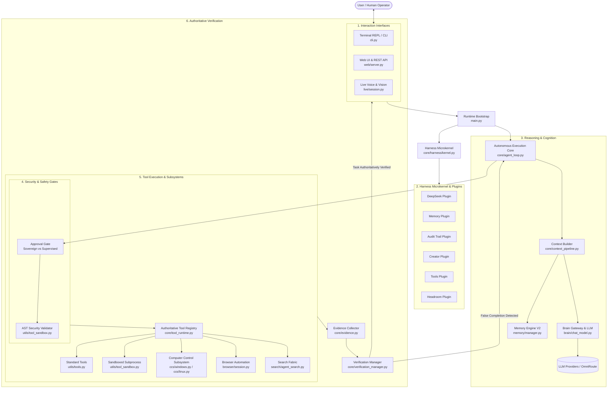

# Kratos Agent — Complete Architecture & Technical Documentation

Welcome to the comprehensive technical documentation for the **Kratos Agent** codebase. This guide details the complete architecture, subsystem components, data flows, security boundaries, and execution models across the entire repository.

---

## 1. System Architecture Blueprint

Kratos is an autonomous, sovereign engineering agent designed for end-to-end software development, computer control, and real-time multimodal interaction.

---

## 2. Documentation Directory Map

Each subsystem has a dedicated documentation folder detailing its modules, classes, technical signatures, arguments, and failure modes:

| Subsystem | Folder | Key Topics Covered |
|---|---|---|
| **Brain & LLM Gateway** | [`documentation/brain/`](file:///c:/Users/thiru/Documents/Kratos_Agent/documentation/brain/README.md) | Proxy-bypassing client, SSE streaming, LangChain chat model, regex fallback tool extraction, endpoint auto-resolution |
| ↳ `brain.py` | [`documentation/brain/brain.py.md`](file:///c:/Users/thiru/Documents/Kratos_Agent/documentation/brain/brain.py.md) | `get_http_client`, `create_brain_llm`, `get_agent_response` |
| ↳ `client.py` | [`documentation/brain/client.py.md`](file:///c:/Users/thiru/Documents/Kratos_Agent/documentation/brain/client.py.md) | `BrainClient`, connection pooling, zero-proxy enforcement, exponential backoff |
| ↳ `chat_model.py` | [`documentation/brain/chat_model.py.md`](file:///c:/Users/thiru/Documents/Kratos_Agent/documentation/brain/chat_model.py.md) | `BrainChatModel`, command sanitization, fallback tool parsing |
| ↳ `config.py` | [`documentation/brain/config.py.md`](file:///c:/Users/thiru/Documents/Kratos_Agent/documentation/brain/config.py.md) | Environment precedence, endpoint derivations, model caching, exception hierarchy |
| **Browser Automation** | [`documentation/browser/`](file:///c:/Users/thiru/Documents/Kratos_Agent/documentation/browser/README.md) | Browser context facade, CDP health, Playwright integration, readiness probes |
| **Core Runtime Engine** | [`documentation/core/`](file:///c:/Users/thiru/Documents/Kratos_Agent/documentation/core/README.md) | Autonomous agent loop, false completion gating, harness microkernel, permission tiers |
| ↳ `agent_loop.py` | [`documentation/core/agent_loop.py.md`](file:///c:/Users/thiru/Documents/Kratos_Agent/documentation/core/agent_loop.py.md) | Multi-turn reasoning loop, step execution, loop-bounding heuristics |
| ↳ `harness.md` | [`documentation/core/harness.md`](file:///c:/Users/thiru/Documents/Kratos_Agent/documentation/core/harness.md) | `HarnessKernel`, plugin contracts, crash isolation, declarative manifest, presets |
| ↳ `tool_runtime.md` | [`documentation/core/tool_runtime.md`](file:///c:/Users/thiru/Documents/Kratos_Agent/documentation/core/tool_runtime.md) | `ToolRegistry`, `ToolSpec`, `ToolPermission` (`READ`, `WRITE`, `EXECUTE`, `ADMIN`) |
| **Computer Control (CCS)** | [`documentation/ccs/`](file:///c:/Users/thiru/Documents/Kratos_Agent/documentation/ccs/README.md) | Native accessibility tree (UIA on Windows, AT-SPI on Linux), UI assertions, doctor |
| **Computer-Use Runtime** | [`documentation/computer/`](file:///c:/Users/thiru/Documents/Kratos_Agent/documentation/computer/README.md) | Desktop observer, execution coordinator, dialog recovery, state caching |
| **Cognitive Memory V2** | [`documentation/memory/`](file:///c:/Users/thiru/Documents/Kratos_Agent/documentation/memory/README.md) | Working, Episodic, Semantic, Procedural, Error, and Application memory layers |
| **Utilities & Sandboxing** | [`documentation/utils/`](file:///c:/Users/thiru/Documents/Kratos_Agent/documentation/utils/README.md) | Tool catalog, self-tool creator, shell quote escaping |
| ↳ `tool_sandbox.py` | [`documentation/utils/tool_sandbox.py.md`](file:///c:/Users/thiru/Documents/Kratos_Agent/documentation/utils/tool_sandbox.py.md) | Static AST security analysis, subprocess execution, verification test, audit log |
| **Live Voice & Vision** | [`documentation/live/`](file:///c:/Users/thiru/Documents/Kratos_Agent/documentation/live/README.md) | Full-duplex audio, VAD, echo cancellation, desktop screen capture, avatar animation |
| **Master/Slave Multi-Agent** | [`documentation/master_slave_orchestrator/`](file:///c:/Users/thiru/Documents/Kratos_Agent/documentation/master_slave_orchestrator/README.md) | Hierarchical supervisor, protocol messages, bounded slave executors, mission recovery |
| **Search Fabric & Retrieval**| [`documentation/retrieval_and_search/`](file:///c:/Users/thiru/Documents/Kratos_Agent/documentation/retrieval_and_search/README.md) | Multi-provider web search, hybrid dense/sparse retrieval, semantic intent classifier |
| **System & Executors** | [`documentation/system_and_executors/`](file:///c:/Users/thiru/Documents/Kratos_Agent/documentation/system_and_executors/README.md) | Async event bus, specialized executors, Rich TUI live renderer, FastAPI web server |
| **CLI & Runtime Bootstrap** | [`documentation/cli_and_runtime/`](file:///c:/Users/thiru/Documents/Kratos_Agent/documentation/cli_and_runtime/README.md) | Interactive REPL, slash commands (`/tools`, `/create-tool`, `/doctor`, `/mode`) |

---

## 3. End-to-End Request Lifecycle

1. **Input Ingestion**: The user issues a goal via the CLI, Web UI, or Live Voice.
2. **Intent & Preflight**: The query is classified by `semantic.intent`. In Supervised mode, dangerous operations prompt the operator; in Sovereign mode, Kratos proceeds autonomously.
3. **Context Assembly**: `core.context_pipeline` gathers:
   - System instructions & personality
   - Relevant project memories recalled by `memory.manager`
   - Active skills and tool schemas from `core.tool_runtime`
   - Working directory status and file tree
4. **Deliberation**: `brain.chat_model` invokes the inference provider via `brain.client` (with `trust_env=False` to bypass system proxy latency).
5. **Tool Dispatch & Sandboxing**:
   - If the model calls standard tools (`write_file`, `run_terminal_command`, `git_status`), they are routed through `core.tool_runtime` with permission checks.
   - If the model forges a new tool (`/create-tool`), it passes through `utils.tool_sandbox` (AST static analysis -> companion smoke test -> audit logging -> subprocess wrapper).
   - If the model interacts with desktop applications, it routes through `ccs` (accessibility tree nodes) rather than raw mouse pixels.
6. **Authoritative Verification**:
   - When the model claims the task is complete, `core.verification_manager` runs post-condition checks against filesystem evidence and test outcomes.
   - Verbal hallucinations of completion are rejected, forcing the agent to continue until real evidence exists.
7. **Memory Consolidation**: Successful workflows and encountered error fixes are indexed into `memory.manager` for permanent retention across sessions.
