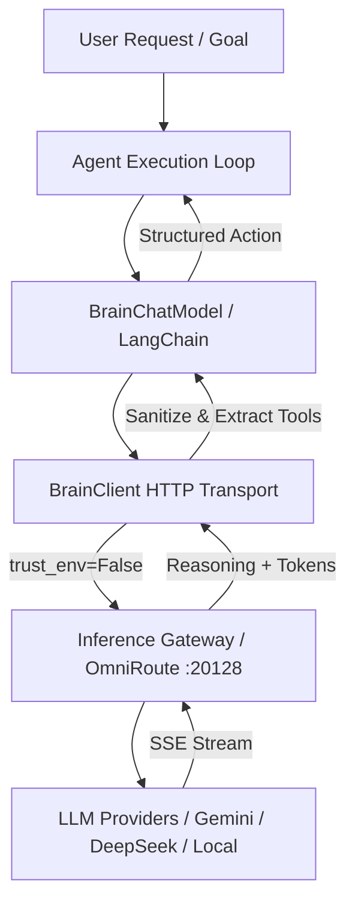

# Subsystem: Brain & Gateway Integration

The `brain` subsystem manages LLM connectivity, streaming, model routing, and LangChain integration across Kratos.

```
src/kratos_agent/brain/
├── __init__.py      # Package export barrel
├── brain.py         # High-level factory methods (create_brain_llm, get_agent_response)
├── chat_model.py    # LangChain BaseChatModel with resilient tool extraction
├── client.py        # Raw requests.Session HTTP client with zero-proxy & SSE streaming
├── config.py        # Environment variables, endpoint resolution, & model discovery
└── fetch_model.py   # Quick CLI helper script to print available models
```

---

## Detailed Module Documentation

1. [`brain.py.md`](file:///c:/Users/thiru/Documents/Kratos_Agent/documentation/brain/brain.py.md):
   - [`get_http_client()`](file:///c:/Users/thiru/Documents/Kratos_Agent/src/kratos_agent/brain/brain.py#L15): Returns `httpx.Client` with `trust_env=False`.
   - [`create_brain_llm(...)`](file:///c:/Users/thiru/Documents/Kratos_Agent/src/kratos_agent/brain/brain.py#L20): Builds LangChain `ChatOpenAI` configured for Kratos gateway.
   - [`get_agent_response(...)`](file:///c:/Users/thiru/Documents/Kratos_Agent/src/kratos_agent/brain/brain.py#L39): One-shot synchronous generation.

2. [`client.py.md`](file:///c:/Users/thiru/Documents/Kratos_Agent/documentation/brain/client.py.md):
   - `BrainClient` / `OmnirouteClient`: Connection pooling, zero-proxy enforcement, OpenAI envelope generation, SSE parsing, and retry mechanics.

3. [`chat_model.py.md`](file:///c:/Users/thiru/Documents/Kratos_Agent/documentation/brain/chat_model.py.md):
   - `BrainChatModel`: LangChain `BaseChatModel` integration with AST/regex fallback tool call parser and command payload sanitizers.

4. [`config.py.md`](file:///c:/Users/thiru/Documents/Kratos_Agent/documentation/brain/config.py.md):
   - Environment resolution (`BRAIN_*`, `OMNI_*`, `KRATOS_*`), authentication headers, endpoint resolution, cached model discovery (`fetch_models`), and `BrainError` hierarchy.

---

## Gateway Routing Architecture


