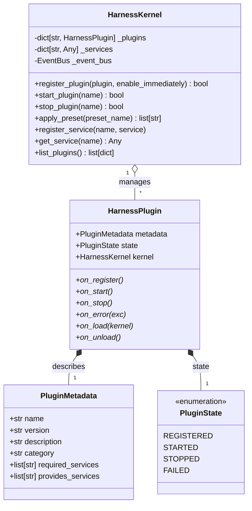

# Subsystem: Harness Kernel & Plugin Architecture
## Package: `kratos_agent.core.harness`

Source Directory: [`src/kratos_agent/core/harness/`](file:///c:/Users/thiru/Documents/Kratos_Agent/src/kratos_agent/core/harness/)

---

### 1. Architectural Purpose & Overview

The `HarnessKernel` provides an extensible, modular microkernel inside Kratos. It allows subsystems (model adapters, memory engines, audit loggers, meta-programming tools, and Headroom latency optimizers) to be loaded as versioned, isolated plugins.

Key architectural features implemented in Phase A:
1. **Explicit Plugin Contract (`HarnessPlugin`)**: Every plugin declares metadata, `version`, `required_services`, `provides_services`, and lifecycle methods.
2. **Crash & Failure Isolation**: If a plugin throws an unhandled exception during `on_start()` or runtime execution, the kernel catches the error, transitions the plugin to `PluginState.FAILED`, calls `on_error(exc)`, and continues running without bringing down the agent.
3. **Declarative Plugin Manifest (`manifest.json`)**: Plugins are cataloged declaratively with default presets (`full`, `minimal`, `sovereign`, `developer`).
4. **Service Dependency Validation**: Before starting a plugin, the kernel verifies that all services declared in `required_services` are registered. If missing, it safely transitions the plugin to `FAILED` and logs the unmet dependency.



---

### 2. Built-in Plugins Catalog

All built-in plugins reside in [`src/kratos_agent/core/harness/plugins/`](file:///c:/Users/thiru/Documents/Kratos_Agent/src/kratos_agent/core/harness/plugins/):

1. **`deepseek_model_plugin.py` (`DeepSeekModelPlugin`)**:
   - Version: `1.0.0`
   - Services Provided: `["model:deepseek"]`
   - Purpose: Direct integration with DeepSeek-R1 / DeepSeek-V3 models, reasoning token handling, and cost/token estimation.
2. **`memory_plugin.py` (`MemoryPlugin`)**:
   - Version: `1.0.0`
   - Services Provided: `["memory"]`
   - Purpose: Connects multi-tier cognitive memory to the kernel, publishing memory state events.
3. **`audit_plugin.py` (`AuditPlugin`)**:
   - Version: `1.0.0`
   - Services Provided: `["audit"]`
   - Purpose: Records append-only JSON event logs for compliance and debugging.
4. **`creator_plugin.py` (`CreatorPlugin`)**:
   - Version: `1.0.0`
   - Services Provided: `["creator"]`
   - Purpose: Autonomous authoring, AST security validation, and dynamic compilation of new plugins.
5. **`tools_plugin.py` (`ToolsPlugin`)**:
   - Version: `1.0.0`
   - Services Provided: `["tools"]`
   - Purpose: Bridges the kernel to the authoritative `ToolRegistry`.
6. **`headroom_plugin.py` (`HeadroomPlugin`)**:
   - Version: `1.0.0`
   - Services Provided: `["headroom"]`
   - Purpose: Integrates Headroom AI for real-time prompt compaction and token caching.

---

### 3. Presets & Manifest

The kernel supports loading predefined configurations via `apply_preset(name)`:
- **`sovereign`**: `tools`, `memory`, `audit`
- **`full`**: `deepseek`, `memory`, `audit`, `creator`, `tools`, `headroom`
- **`minimal`**: `tools`, `memory`
- **`developer`**: `deepseek`, `memory`, `audit`, `creator`, `tools`

### 4. CLI Inspection

Operators can inspect active plugins, states, and versions directly in the CLI using:
```bash
/plugins
```
This produces a Rich-formatted status table displaying plugin names, versions, states (`STARTED`, `STOPPED`, `FAILED`), and exported services.
