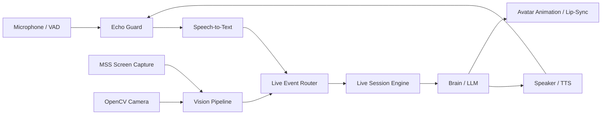

# Subsystem: Live Multimodal Real-Time Voice & Vision
## Package: `kratos_agent.live`

Source Directory: [`src/kratos_agent/live/`](file:///c:/Users/thiru/Documents/Kratos_Agent/src/kratos_agent/live/)

---

### 1. Architectural Purpose & Overview

The `live` subsystem enables real-time, hands-free conversational interaction with Kratos. It combines full-duplex speech recognition, text-to-speech synthesis, acoustic echo cancellation, screen observation, webcam perception, and an animated avatar.

---

### 2. Core Modules & Key Components

#### [`session.py`](file:///c:/Users/thiru/Documents/Kratos_Agent/src/kratos_agent/live/session.py): `LiveSession`
- Full-duplex session coordinator.
- Orchestrates concurrent background loops:
  - Input stream ingestion (audio packets from `microphone.py`).
  - Screen capture stream (periodic frames from `screen.py`).
  - TTS speech delivery (`speaker.py`).
  - Tool execution interruption when the user speaks (barge-in support).

#### [`avatar.py`](file:///c:/Users/thiru/Documents/Kratos_Agent/src/kratos_agent/live/avatar.py): `AvatarRenderer`
- Renders the interactive visual avatar.
- Synchronizes mouth movement and facial phonemes with active speech waveforms.
- Emits animation state to the frontend web canvas via WebSocket.

#### [`echo_guard.py`](file:///c:/Users/thiru/Documents/Kratos_Agent/src/kratos_agent/live/echo_guard.py): `EchoGuard`
- Prevents the agent from hearing its own voice output through the microphone.
- Applies software ducking and temporary audio threshold gating during TTS playback.

#### [`screen.py`](file:///c:/Users/thiru/Documents/Kratos_Agent/src/kratos_agent/live/screen.py) & [`camera.py`](file:///c:/Users/thiru/Documents/Kratos_Agent/src/kratos_agent/live/camera.py)
- High-performance visual capture using `mss` (desktop) and `opencv-python` (webcam).
- Downsamples and crops frames for minimal latency and token efficiency.

#### [`speaker.py`](file:///c:/Users/thiru/Documents/Kratos_Agent/src/kratos_agent/live/speaker.py) & [`microphone.py`](file:///c:/Users/thiru/Documents/Kratos_Agent/src/kratos_agent/live/microphone.py)
- Low-latency audio I/O using `PyAudio` and `sounddevice`.
- Includes energy-based VAD (Voice Activity Detection) to detect conversational pauses.
