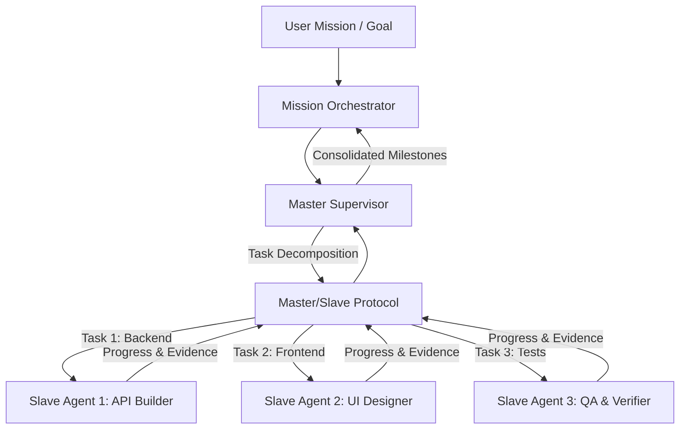

# Subsystem: Master/Slave Multi-Agent & Orchestrator
## Packages: `kratos_agent.master`, `kratos_agent.slave`, `kratos_agent.orchestrator`

Source Directories:
- [`src/kratos_agent/master/`](file:///c:/Users/thiru/Documents/Kratos_Agent/src/kratos_agent/master/)
- [`src/kratos_agent/slave/`](file:///c:/Users/thiru/Documents/Kratos_Agent/src/kratos_agent/slave/)
- [`src/kratos_agent/orchestrator/`](file:///c:/Users/thiru/Documents/Kratos_Agent/src/kratos_agent/orchestrator/)

---

### 1. Architectural Purpose & Overview

Kratos supports hierarchical multi-agent coordination. Instead of forcing a single model context to handle an entire complex multi-hour mission, Kratos splits responsibilities into:
1. **Master Supervisor (`kratos_agent.master`)**: High-level planner and architect that decomposes missions, tracks global milestones, manages budgets, and arbitrates disputes.
2. **Worker Slaves (`kratos_agent.slave`)**: Specialized, bounded execution agents running focused tasks (e.g. "implement auth module", "write test suite", "scrape documentation") with isolated working memory.
3. **Mission Orchestrator (`kratos_agent.orchestrator`)**: Lifecycle coordinator that persists global mission state, handles agent failover, and enforces dependencies.

---

### 2. Core Modules & Key Classes

#### Master (`kratos_agent.master`)
- **[`supervisor.py`](file:///c:/Users/thiru/Documents/Kratos_Agent/src/kratos_agent/master/supervisor.py): `MasterSupervisor`**:
  - Decomposes high-level missions into Directed Acyclic Graphs (DAG) of subtasks.
  - Spawns and manages slave worker lifecycles.
  - Evaluates slave task completion evidence before unlocking dependent tasks.
- **[`protocol.py`](file:///c:/Users/thiru/Documents/Kratos_Agent/src/kratos_agent/master/protocol.py)**:
  - Strongly typed JSON message schemas (`TaskAssignment`, `TaskUpdate`, `TaskCompletionReport`, `Heartbeat`).

#### Slave (`kratos_agent.slave`)
- **[`executor.py`](file:///c:/Users/thiru/Documents/Kratos_Agent/src/kratos_agent/slave/executor.py): `SlaveExecutor`**:
  - Executes assigned tasks with scoped tools and budget.
  - Periodically emits progress heartbeats and telemetry to the Master.
- **[`dispatcher.py`](file:///c:/Users/thiru/Documents/Kratos_Agent/src/kratos_agent/slave/dispatcher.py)**:
  - Ingestion queue decoupling network reception from worker thread execution.

#### Orchestrator (`kratos_agent.orchestrator`)
- **[`mission.py`](file:///c:/Users/thiru/Documents/Kratos_Agent/src/kratos_agent/orchestrator/mission.py): `Mission`**:
  - Encapsulates target goals, budget constraints, active tasks, and completion criteria.
- **[`recovery.py`](file:///c:/Users/thiru/Documents/Kratos_Agent/src/kratos_agent/orchestrator/recovery.py)**:
  - Detects deadlocked or unresponsive slave agents, reclaiming tasks and reassigning them.
