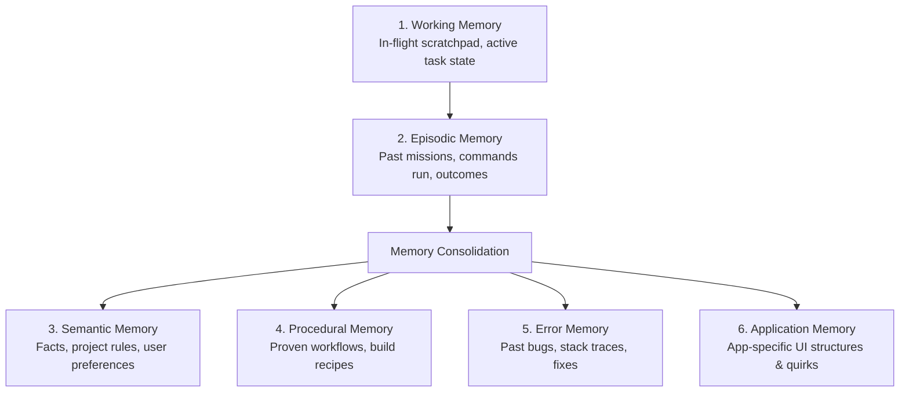

# Subsystem: Multi-Tier Cognitive Memory Engine V2
## Package: `kratos_agent.memory`

Source Directory: [`src/kratos_agent/memory/`](file:///c:/Users/thiru/Documents/Kratos_Agent/src/kratos_agent/memory/)

---

### 1. Architectural Purpose & Overview

The Memory Engine V2 provides Kratos with durable, cross-session intelligence. Rather than relying solely on raw context windows, Kratos organizes knowledge into distinct cognitive layers with automatic importance ranking, decay, and consolidation.

```
src/kratos_agent/memory/
├── __init__.py          # Package exports
├── application.py       # Application-specific memory store
├── consolidation.py     # Background memory consolidation & summarization
├── decay.py             # Time-based decay and reinforcement algorithms
├── episodic.py          # Episodic memory layer (past task runs & outcomes)
├── errors.py            # Error memory store (known pitfalls & solutions)
├── manager.py           # Unified MemoryManager API coordinator
├── models.py            # Data models (MemoryRecord, MemoryLayer, MemoryScope)
├── procedural.py        # Procedural workflows & multi-step skill memories
├── ranking.py           # Hybrid relevance, importance, & recency ranking
├── retrieval.py         # Multi-index retrieval engine
├── semantic.py          # Semantic factual memory layer
├── session.py           # Session-scoped ephemeral memory
├── store.py             # Low-level durable storage backend
└── working.py           # Active scratchpad & working memory
```

---

### 2. Memory Layers (`MemoryLayer`)



1. **`WORKING`**: High-churn active scratchpad holding immediate conversation context.
2. **`EPISODIC`**: Chronological record of completed missions, tool executions, and user feedback.
3. **`SEMANTIC`**: Generalized facts, architecture rules, and user preferences.
4. **`PROCEDURAL`**: Reusable operational playbooks and multi-step recipes (`WorkflowRecord`).
5. **`APPLICATION`**: Knowledge tailored to specific software applications (e.g. VS Code shortcuts, browser settings).
6. **`ERROR`**: Failure catalog tracking encountered stack traces and their working resolutions.

---

### 3. Core Class: `MemoryManager`

#### Key Methods

##### `remember(...) -> MemoryRecord`
Stores a new memory entry into the system:
```python
def remember(
    self,
    content: str,
    layer: MemoryLayer = MemoryLayer.SEMANTIC,
    scope: MemoryScope = MemoryScope.GLOBAL,
    importance: float = 0.5,
    confidence: float = 0.8,
    metadata: dict[str, Any] | None = None,
    tags: list[str] | None = None,
) -> MemoryRecord
```

##### `recall(...) -> list[MemoryRecord]`
Recalls context-aware ranked memories matching a query:
```python
def recall(
    self,
    text: str,
    task: str | None = None,
    application: str | None = None,
    project: str | None = None,
    scope: MemoryScope | None = None,
    layer: MemoryLayer | None = None,
    limit: int = 5,
    min_confidence: float = 0.20,
) -> list[MemoryRecord]
```
- Computes composite relevance scores based on:
  $$\text{Score} = w_r \cdot \text{Relevance} + w_i \cdot \text{Importance} + w_t \cdot \text{Recency} + w_c \cdot \text{Confidence}$$

##### `consolidate() -> ConsolidationReport`
Merges redundant observations, promotes high-utility episodic memories into semantic knowledge, and applies decay to obsolete facts.
