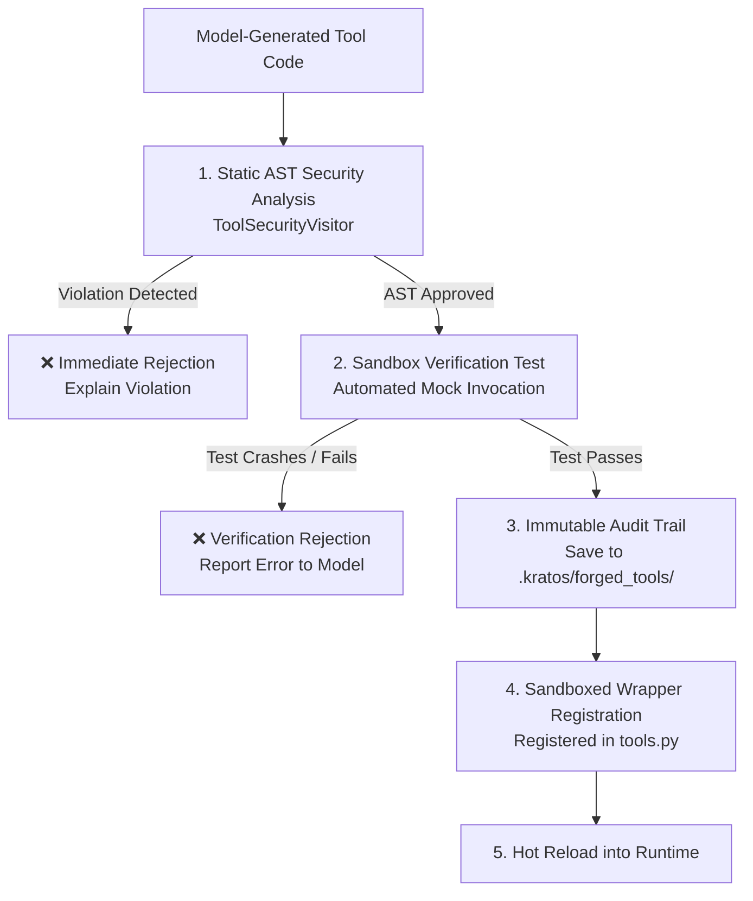

# Subsystem: Tool Sandboxing & Meta-Programming Security
## Module: `kratos_agent.utils.tool_sandbox`

Source File: [`src/kratos_agent/utils/tool_sandbox.py`](file:///c:/Users/thiru/Documents/Kratos_Agent/src/kratos_agent/utils/tool_sandbox.py)

---

### 1. Architectural Purpose & Overview

Implemented in Phase B of the security roadmap, `tool_sandbox.py` shields Kratos from untrusted, buggy, or malicious Python code generated by LLMs during autonomous tool forging (`/create-tool`, `self_tool_creator`).

Before this subsystem existed, forged tools were executed dynamically inside the host Python process, posing severe stability and security risks. `tool_sandbox.py` enforces a **defense-in-depth pipeline**:



---

### 2. Security Layers & Functions

#### 1. Static AST Analysis: `validate_tool_ast(...)`
```python
def validate_tool_ast(
    code: str,
    tool_name: str | None = None,
    allow_subprocess: bool = False,
) -> tuple[bool, str | None]
```
- **AST Visitor**: `ToolSecurityVisitor`
- **Enforced Security Invariants**:
  - **Module Imports**: Rejects `subprocess`, `pty`, `commands`, `ctypes`, `socket`.
  - **Dangerous OS Operations**: Rejects `os.system`, `os.popen`, `os.rmdir`, `os.remove`, `os.unlink`, `os.chmod`, `os.chown`, `os.kill`.
  - **Dangerous Shutil Operations**: Rejects `shutil.rmtree`, `shutil.move`.
  - **Dynamic Evaluation**: Rejects `eval`, `exec`, `compile`, `__import__`, `globals`, `locals`.
  - **Introspection Escapes**: Rejects `__subclasses__`, `__globals__`, `__code__`, `__bases__`, `__mro__`, `__builtins__`.
  - **Filesystem Traversal**: Rejects path traversal sequences (`..`) and sensitive root prefixes (`/etc`, `/root`, `C:\Windows`).

---

#### 2. Subprocess Sandboxing: `execute_sandboxed_tool(...)`
```python
def execute_sandboxed_tool(
    code: str,
    func_name: str,
    kwargs: dict[str, Any] | None = None,
    args: list[Any] | None = None,
    timeout: float = 10.0,
) -> dict[str, Any]
```
- **Process Isolation**: Executes the function in a standalone `python` child process.
- **Stripped Environment**: All environment variables containing credentials (`KEY`, `TOKEN`, `SECRET`, `PASSWORD`, `AUTH`, `API`, `CRED`, or starting with `KRATOS_`, `OPENAI_`, `AWS_`, etc.) are scrubbed.
- **Filesystem Isolation**: Runs with `cwd` set to an ephemeral temporary directory (`tempfile.TemporaryDirectory()`).
- **Resource Limits**: Hard timeout defaulting to 10.0s terminates hanging or infinite loops (`TimeoutExpired`).
- **IPC Protocol**: Communicates via standard JSON over `stdin` and `stdout`.

---

#### 3. Companion Smoke Verification: `verify_tool_in_sandbox(...)`
```python
def verify_tool_in_sandbox(
    code: str,
    tool_name: str,
    parameters_schema: dict[str, Any] | None = None,
    timeout: float = 5.0,
) -> tuple[bool, str | None]
```
- Derives mock parameters based on parameter JSON schema types (strings, integers, booleans, arrays).
- Executes the tool inside the sandbox.
- If the tool crashes or returns an error, registration is aborted.

---

#### 4. Audit Logging: `log_forged_tool_audit(...)`
```python
def log_forged_tool_audit(
    tool_name: str,
    code: str,
    author_model: str = "kratos",
    trigger_prompt: str = "",
    workspace: Path | None = None,
) -> Path
```
- Generates an immutable record at `.kratos/forged_tools/<tool_name>_<timestamp>.py`.
- Includes a SHA-256 hash of the code, timestamp, author model, and trigger prompt.
